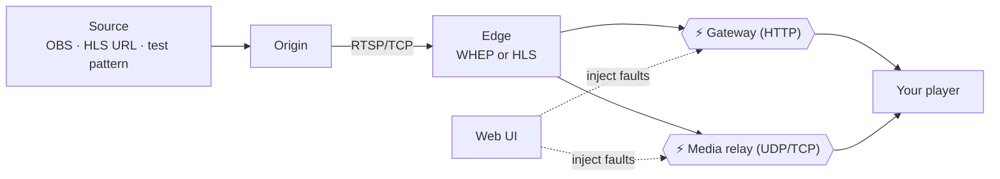

# Stream Fault Lab — One-Pager

> **A local "bad network simulator" for live video.** Break the stream on purpose, on your own Mac, and watch how your player copes.

---

## The problem

Live-video players look fine on a healthy network. Real users are on flaky Wi-Fi, VPNs, congested cellular, and behind CDNs that return errors. These failures are hard to reproduce on demand, so player recovery logic (retries, backoff, reconnects) often ships under-tested.

## What the lab does

Stream Fault Lab runs a miniature streaming stack locally and sits **between your player and the stream**. From a web UI you inject a fault, then observe whether your player stalls, retries, recovers, or gets stuck.

- **Protocols:** WHEP / WebRTC and HLS (including LL-HLS)
- **Setup:** one command, `./start.sh`, then open http://localhost:9091
- **Requires:** macOS, Python 3.11+, FFmpeg. No Docker, database, or frontend build.

## Who it's for

| Role | How it helps |
| --- | --- |
| Player / app engineers | Reproduce failures deterministically and verify recovery logic |
| QA | Repeatable fault scenarios instead of "turn off Wi-Fi and hope" |
| Anyone curious | Built-in reference player and live server logs show what happens |

## Data flow



Text version:

**1. Source → Origin → Edge**

```text
  ┌──────────────────────┐
  │  Source (pick one)   │   OBS via WHIP  ·  HLS URL (via FFmpeg)  ·  Generated test pattern
  └──────────┬───────────┘
             ▼
  ┌──────────────────────┐
  │  Origin (MediaMTX)   │   receives and holds the live stream (H.264 + Opus)
  └──────────┬───────────┘
             │  RTSP / TCP
             ▼
  ┌──────────────────────┐
  │  Edge (MediaMTX)     │   serves only the selected output: WHEP or HLS
  └──────────┬───────────┘
             ▼  (continues below)
```

**2. Edge → Your player, through the fault points**

```text
  WHEP / WebRTC
    signaling (HTTP) ───▶ ⚡ Gateway ─────────────────▶ Player
    media (UDP/TCP)  ───▶ ⚡ Media relay ─────────────▶ Player

  HLS
    playlists + segments ─▶ ⚡ Gateway ───────────────▶ Player

  ⚡ = where faults are injected
```

The **Gateway** (HTTP) and **Media relay** (UDP/TCP) are the two places the lab can tamper with traffic. The origin and edge are ordinary, healthy servers.

## What you can break

| Area | Examples |
| --- | --- |
| HTTP errors | 401, 403, 404, 410, 429, 502, 503, Retry-After, delays, timeouts |
| WebRTC setup | Unreachable ICE, DTLS mismatch, invalid SDP, redirects |
| Network blackout | Drop all traffic or UDP only, in either direction |
| Silent media stall | Stop video or audio while the connection looks healthy |
| Poor quality | Packet loss, jitter, latency, reordering, bandwidth caps |
| Infrastructure | Stop the origin or the edge mid-stream |
| HLS | Stale playlists, truncated segments |
| Repeat failures | Fail, recover, fail again, for up to 20 rounds |

Press **Restore healthy** at any time to clear everything.

## A 60-second example

1. Start the lab and choose **WHEP**, then **Generated test stream**.
2. Point your player at `http://127.0.0.1:8080/live/whep`.
3. Apply **All transport traffic blackout** for 15 seconds.
4. Watch what your player does, and how long it takes to show a frame again.

## What you get back

- **Live server logs:** requests, faults, relay byte counts, process state
- **Reference player stats:** ICE state, stalls, loss, jitter
- **Exportable traces:** JSONL, with SDP, cookies, and credentials left out

## Good to know

- Local, unauthenticated test tool. Don't expose it publicly.
- Phones work: set `PUBLIC_HOST` to your Mac's LAN IP.
- The built-in reference player has no recovery logic. It shows what the network did, not how your app should behave.
- Server counters show what was sent, not what a viewer saw. Judge recovery from your player's own logs.

**Learn more:** [README.md](README.md) · [VALIDATION.md](VALIDATION.md) · [PLAYER_TEST_RESULTS.md](PLAYER_TEST_RESULTS.md)
