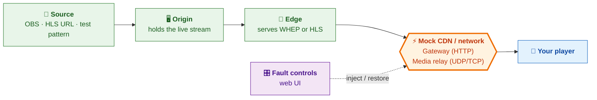

# Stream Fault Lab

Break a live stream on purpose, on your Mac, and see how your player copes. Supports WebRTC (WHEP) and HLS / LL-HLS.



## Quick start

```sh
brew install python ffmpeg   # once
./start.sh                   # then open http://localhost:9091
```

1. Choose **WHEP** or **HLS**, then **Generated test stream** → **Use this source**.
2. Play in your own player:
   - WHEP: `http://127.0.0.1:8080/live/whep`
   - HLS: `http://127.0.0.1:8080/live/index.m3u8`
3. Pick a fault, then **Apply fault**. **Restore healthy** clears it.

Press **Ctrl+C** to stop everything. For a phone, set `PUBLIC_HOST` to your Mac's LAN IP (see `.env.example`).

## Docs

| Doc | What's in it |
| --- | --- |
| [One-pager](ONE_PAGER.md) | What it tests and how the CDN is mocked |
| [Full reference](docs/REFERENCE.md) | Sources, faults, TURN, logs, ports |
| [Validation](VALIDATION.md) | Recorded checks |
| [Player results](PLAYER_TEST_RESULTS.md) | Observed player behavior |

Local, unauthenticated test tool. Don't expose it publicly.
