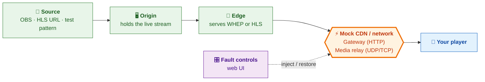

# Stream Fault Lab

**Break a live stream on purpose, on your Mac, and see how your player copes.**
Supports WebRTC (WHEP) and HLS / LL-HLS. Start with `./start.sh`, then open http://localhost:9091.

## How it works



Everything left of the orange box is healthy. The orange box sits between the edge and your player, like a CDN or the internet would. It is where faults are injected.

## What you can test

| 🌐 Server and CDN behavior | 📶 Network conditions | 💥 Infrastructure |
| --- | --- | --- |
| HTTP errors: 401, 403, 404, 410, 429, 502, 503 | Full or UDP-only blackout | Origin goes down |
| Retry-After and slow responses | Packet loss, jitter, latency | Edge restarts mid-stream |
| Timeouts and redirects | Bandwidth caps | Repeated fail / recover cycles |
| Stale playlists, truncated segments | Video or audio freezes silently | TURN and VPN paths |

## What it helps with

- **Reproduce failures on demand** instead of "turn off Wi-Fi and hope".
- **Check recovery:** does the player retry, back off, reconnect, and show video again?
- **Compare runs** with the same fault, duration, and seed after each fix.
- **See both sides:** the lab's server logs next to your player's own logs.

## How a CDN is mocked and verified

The **Gateway** stands in for a CDN. Your player fetches from it exactly as it would from a CDN URL, and the lab changes what comes back.

| Real-world CDN problem | How the lab mocks it | What to verify in your player |
| --- | --- | --- |
| Rate limiting (429) | Return 429 with a chosen Retry-After | Player waits at least that long before retrying |
| Origin errors (502/503) | Return the error for a set time | Retries use backoff and stop after a limit |
| Expired token (401/403) | Return 401/403 | Player refreshes auth instead of looping |
| Stream ended (404/410) | Return 404/410 | Player stops retrying and shows an end state |
| Slow or hung edge | Delay or hold the response | Exiting the player cancels the pending request |
| Stale cache | Serve an old playlist as if healthy | Player notices the frozen live edge |
| Cut-off download | Send part of a segment, then close | Player retries and does not crash |
| Redirect to another edge | One HTTP 307 on the setup POST | Player follows it and keeps the method |

**Verify** by applying a fault, watching your player, then checking the lab's log. Each gateway request shows its method, path, status, duration, and fault ID, so you can match the lab's action to what your player did. Press **Restore healthy** and measure how long the first recovered frame takes.

This mocks CDN *behavior* on one local edge. It is not a real multi-CDN setup, so DNS, TLS, and failover between CDNs still need a real environment.

## Quick start

```sh
brew install python ffmpeg   # once
./start.sh                   # then open http://localhost:9091
```

1. Choose **WHEP** or **HLS**, then **Generated test stream** → **Use this source**.
2. Play in your player: WHEP `http://127.0.0.1:8080/live/whep` · HLS `http://127.0.0.1:8080/live/index.m3u8`
3. Apply **All transport traffic blackout** for 15 seconds, watch what your player does, and time the recovery.
4. **Restore healthy** clears any fault. **Ctrl+C** stops everything.

## Good to know

- Local, unauthenticated tool. Don't expose it publicly.
- For a phone, set `PUBLIC_HOST` to your Mac's LAN IP.
- The built-in reference player has no recovery logic. Judge recovery from your own player's logs.

**More detail:** [Full reference](docs/REFERENCE.md) · [Advanced: TURN & LL-HLS](docs/ADVANCED.md) · [Testing](docs/TESTING.md)
