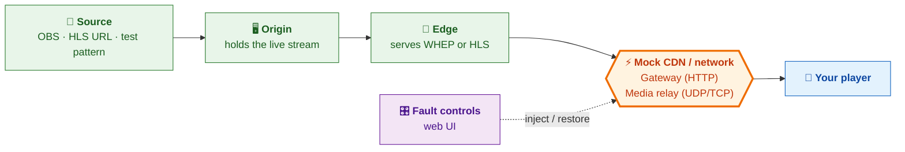

# Stream Fault Lab

A local lab for testing HTTP delivery, WebRTC media stalls, impaired delivery, and source/edge recovery. Runs directly on macOS. No Docker, Node.js, database, or frontend build is required.

> New here? Read the [README](../README.md) for a quick overview.

## At a glance



| Step | Command |
| --- | --- |
| 1. Install prerequisites (once) | `brew install python ffmpeg` |
| 2. Start the lab | `./start.sh` |
| 3. Open the controller | http://localhost:9091 |
| 4. Play | WHEP: `http://127.0.0.1:8080/live/whep` · HLS: `http://127.0.0.1:8080/live/index.m3u8` |

## Start on your Mac

You need Python 3.11+ and FFmpeg. If needed, install them once with Homebrew:

```sh
brew install python ffmpeg
```

From a clone or an extracted copy of this project:

```sh
./start.sh
```

Open **http://localhost:9091**. Choose **WHEP / WebRTC** or **HLS** under **Playback protocol**. Only that output runs; WHEP is the default and the choice is saved across restarts. Select **Generated test stream**, then **Use this source**. Wait until the origin and the selected edge path show `ready`. Click **Play** in the reference player, or copy the selected playback URL into your own player.

The first start installs Python dependencies into `.venv/` and downloads MediaMTX **v1.21.2** into `.runtime/bin/`. The download is verified against pinned SHA-256 digests from the official release. Later starts reuse them. The Chrome HLS preview uses a vendored, integrity-verified hls.js **1.6.13** file, so the UI needs no internet connection. Your HLS source may need internet access.

Press **Ctrl+C** in the terminal to stop the app and every media process it started. It does not stop unrelated processes or change macOS firewall rules. Start it again with the same command. If the controller port is occupied, use `./start.sh --ui-port 9092`. Other occupied ports are reported before media processes start.

## Stack and data flow

| Module | Implementation | Purpose |
| --- | --- | --- |
| Controller and HTTP gateway | Python + aiohttp 3.14.4 | Local UI, fault controls, HTTP forwarding, traces, live SSE logs |
| Origin | Native MediaMTX 1.21.2 process | Receives WHIP or an FFmpeg publisher |
| Edge | Separate native MediaMTX 1.21.2 process | Pulls from the origin over RTSP/TCP; serves the selected WHEP or HLS output |
| Source and audio bridge | Native FFmpeg | Test stream, HLS input conversion, AAC audio for HLS |
| UI and reference player | HTML, CSS, JavaScript; native WebRTC and hls.js | Controller, log viewer, optional pipeline check |

Only one of the two output branches below is active, according to your choice.

```text
OBS --WHIP------------------------> origin /live (H.264 + Opus)
HLS URL --FFmpeg conversion-------> origin /live (H.264 + Opus)
Test pattern --FFmpeg------------> origin /live (H.264 + Opus)
                                       |
                          RTSP/TCP     +--> edge /live --WHEP HTTP--> gateway --> player
                                       |       +------ICE/DTLS/SRTP--> media relay --> player
                                       |
                                  FFmpeg audio bridge
                                  copy H.264, audio to AAC
                                       |
                                  origin /live-hls
                                       |
                                  RTSP/TCP
                                       |
                                  edge /live-hls --HLS HTTP--> gateway /live/... --> player
```

Only the selected output runs. WHEP mode disables edge HLS serving and the audio bridge; HLS mode disables edge WebRTC playback and pulls only `/live-hls`. WHIP ingest at the origin remains available in either mode. Switching the selector clears active faults, stops reference playback, and restarts only the edge; OBS and a lab-owned source stay running. External players must reconnect using the newly selected URL. Inactive output requests return HTTP 409.

The edge can stop while the origin and publisher stay up. WebRTC media bypasses the HTTP gateway and passes through a separate UDP/TCP relay. Healthy WHEP answers advertise its public ports; the edge media listeners are private loopback endpoints. HLS playlists, initialization files, and segments pass through it. WHEP session `Location` values are rewritten to opaque gateway resource aliases; PATCH and DELETE reach the original edge resource. Independent POST requests create independent resources. Edge restart clears its in-memory sessions.

## Input sources

### OBS / WHIP

1. Select **OBS / WHIP** and **Use this source**. This stops a lab-owned test/HLS source; it does not start OBS.
2. In OBS → Settings → Stream, select **WHIP** and use `http://127.0.0.1:8899/live/whip`.
3. Use **H.264 video** and **Opus audio**. Use a 2-second keyframe interval and no B-frames for WebRTC. Start streaming.

WHIP ingest is bound to this Mac's loopback address. OBS should run on this Mac. Stop OBS before switching to generated or HLS input; the origin supports one publisher on `/live`. Other WHIP publishing applications can use the same URL and compatible codecs.

In WHEP mode, the WHIP stream passes through without an HLS branch. In HLS mode, FFmpeg copies its video and converts the audio to AAC on a separate HLS path for browser compatibility. This is not a comparison of identical audio codecs across protocols.

### Pull an HLS URL

Select **Pull an HLS URL**, enter a complete HTTP(S) playlist URL, and select **Use this source**. FFmpeg reads it and encodes H.264/Opus for the origin. When HLS output is selected, the audio bridge produces H.264/AAC; the edge does not offer WHEP playback. This costs CPU and adds delay. An HLS URL is pulled; HLS is not a push publishing endpoint. DRM streams are not supported. A stopped or expired input appears in the logs; select Use this source again to retry. Source URLs stay in process memory and the running FFmpeg command, not in saved configuration, browser storage, or traces. An origin outage restarts a lab-owned input from its in-memory settings.

### Generated test stream

A moving 640×360 pattern at 30fps and a 440Hz audio tone. This is the quickest way to check the lab before connecting OBS. The reference player starts muted.

## Playback URLs and phones

Playback URLs for a player on this Mac (only the selected URL is active):

```text
WHEP: http://127.0.0.1:8080/live/whep
HLS:  http://127.0.0.1:8080/live/index.m3u8
```

For a phone or another LAN device:

```sh
cp .env.example .env
# Set PUBLIC_HOST to this Mac's reachable LAN IPv4 address.
./start.sh
# Or: ./start.sh --public-host 192.168.1.50
```

The player must reach TCP 8080 for HTTP, UDP 8189 for WebRTC, and optionally TCP 8186 for ICE-TCP. The Mac and device must share a reachable network; VPNs and client-isolated Wi-Fi can prevent this. The output URLs and direct ICE candidates use PUBLIC_HOST. With TURN configured, a separate media host identifies the Mac address reachable by the TURN service. Keep every player reconnect pointed at the lab URL.

The controller stays on localhost. The gateway and edge media ports accept LAN clients. Publishing and server control endpoints stay on loopback. This is an unauthenticated local test lab, not a public deployment. The first version serves HTTP; HTTPS webpages and apps that require TLS need a separate TLS setup before they can use it. Safari or Chrome can open the local controller; the reference player does not reconnect automatically and does not represent your production player's recovery policy.

## Fault presets

| Area | Controls | What to inspect in your player |
| --- | --- | --- |
| HTTP | 401, 403, 404, 410, 429, 502, 503; configurable Retry-After for 429/503; delay; timeout | Error classification, auth/session handling, policy backoff, exit cancellation |
| WHEP setup | ICE unreachable, DTLS mismatch, invalid SDP, one HTTP 307 redirect preserving POST | Initial connectivity, negotiation errors, fresh-attempt recovery |
| WHEP lifecycle | HTTP faults scoped to PATCH / DELETE; close active read sessions once | Restart/cleanup handling, new-session recovery without stopping the edge |
| Transport blackout | All UDP/TCP traffic, or UDP only; choose direction | Connection loss, fallback, timeout, retry budget and rendered-frame recovery |
| Silent media stall | All RTP, video only, audio only; STUN/DTLS/RTCP preserved | Frame/audio progress stalls while ICE can remain connected |
| Quality | Random/burst loss, latency, jitter, UDP extra delay/reordering, bandwidth cap, direction; optionally include control traffic | Loss/concealment, freezes, adaptation where supported, recovery after restoration |
| Upstream | Stop origin and lab-owned source, leaving edge up | Upstream failure and return to media; OBS may need to reconnect |
| Edge | Stop edge process, leaving origin/source up | Midstream failure and a new session after restart |
| HLS | Stale successful playlist; truncated media/init download; HTTP faults scoped to playlists/media | Frozen live edge, incomplete responses, retries, bounded buffering and recovery |
| Repeated failures | Finite sequence of the selected fault and healthy intervals | Recovery state resets, one recovery owner, session/resource growth |

Select the affected scope, duration, and options, then **Apply fault**. Only controls for the selected protocol appear. **Restore healthy** cancels a sequence and clears the active fault. Durations are 1–600 seconds; sequences allow up to 20 rounds / 30 minutes. Sequences run only while this lab process is open.

A WHEP POST fault leaves established media running. WHEP lifecycle faults affect PATCH/DELETE; playback scope excludes lifecycle cleanup. Closing active sessions is a one-time action; its countdown does not block new sessions. An HTTP timeout sends no response for up to 60 seconds, even after restoration; already matched delayed requests keep their delay. Test cancellation and late responses by exiting/re-entering your own player while a delay is active.

ICE/DTLS/SDP faults alter new answers only. Existing sessions continue. Restore stops changing new answers; already changed answers require a fresh WHEP attempt. ICE blackhole listeners use UDP 18289 / TCP 18286 only during that fault. DTLS mutation tests certificate fingerprint verification. None of these controls change firewall rules.

Selective audio/video classification uses the negotiated SDP payload types and public RTP headers, associated with each peer through ICE STUN usernames. Media stays encrypted. **All RTP** also drops unknown RTP payload types; audio/video-only controls require a negotiated mapping. Class counters show what was identified and forwarded/discarded.

Quality queues are bounded to 4096 UDP packets / 8 MB and two seconds of delay. Overflow is discarded. Restoration discards queued old packets and clears impairment state. The bandwidth cap is per peer and direction, not one shared CDN-link capacity. A seeded random stream aids repeatability for a stable traffic order. TCP preserves frame order and discards complete application frames; it does not emulate kernel TCP retransmission, congestion control, RST/FIN, or packet reordering.

**UDP blocked** acts on the public media relay. Fresh attempts may select direct ICE TCP. TURN over TCP still has a UDP TURN-to-edge hop, so that hop is blocked too. Validate TURN transports separately; this control does not reproduce an entire VPN/firewall policy.

### TURN and VPN checks

Optional native TURN support:

```sh
brew install coturn
```

1. Restore healthy. Under **TURN / VPN checks**, choose **Local coturn** and enter this Mac's LAN IPv4 address. Keep HTTP's emulator alias if needed; the media host must be reachable by the TURN service. Configure TURN. Existing WHEP sessions close because the edge restarts.
2. **Copy ICE config** and configure these servers in your app before it creates its offer. The gateway also advertises repeated `Link: rel="ice-server"` headers on OPTIONS and POST, exposing Link through CORS. Your WHEP client must support consuming them; the lab does not configure Android automatically.
3. In the reference player, select **Require TURN over UDP** or **Require TURN over TCP**, then Play. Check **TURN route** and transport in the selected-pair readout, together with advancing frames.
4. Repeat on your device with VPN off/on. Save client stats and logs, not just successful signaling. For negative cases, use external configuration with an unreachable server or rejected credentials and verify normal policy behavior.

The local coturn child listens on the supplied Mac IP, UDP/TCP 3478, with UDP relay ports 49160–49200. It is owned by the lab and stops with it; no login service is installed. Credentials are generated for each local configuration. Config files are private and gitignored; status, traces and browser storage omit credentials. Local development loopback use permits loopback peers; use the LAN IP for device tests. Disabling TURN or stopping the lab removes its coturn credential file.

The media proxy can cause Chrome to label the selected local candidate **prflx** rather than **relay**. The readout separately identifies a TURN route from the selected candidate's TURN URL/relay transport; requiring relay-only playback avoids a successful direct path being mistaken for TURN. Trace samples contain the candidate types and transport, never raw candidate addresses or credentials.

External **STUN / TURN / TURN-TLS** accepts RTCConfiguration `iceServers` JSON. TURN/TLS needs a reachable `turns:` service with a trusted certificate. A LAN lab may itself be inaccessible through a VPN or mobile network. Local TURN does not create public routing or a trusted TLS endpoint. TURN configuration and HLS profile are per-run; the playback protocol is saved across restarts.

### LL-HLS profile

Select HLS, then **LL-HLS · 200 ms parts**. The edge restarts with MediaMTX's lowLatency profile, preserving the source. The gateway preserves `_HLS_msn`, `_HLS_part`, and `_HLS_skip` query parameters and rewrites part, map, and preload-hint URIs through the fault path. Actual part durations depend on track timing; segments depend on encoder keyframes. Test playlist delay/timeouts for blocked reload and HLS media faults for partial segments as well as initialization/full segments.

Stale-playlist mode holds the first successful snapshot per path across LL-HLS reload query values. Truncated-download mode sends the retained prefix with the original Content-Length, then closes the connection. These are fault fixtures, not a full CDN cache implementation. Local HTTP LL-HLS is for Android/browser checks; Apple's LL-HLS requirements include HTTPS. Single-rendition output cannot validate ABR fallback between variants.

### Test a mid-stream outage

1. Select WHEP and wait for moving video in your app.
2. Select **All transport traffic blackout**, duration **15 seconds**, then **Apply fault**.
3. Leave the app open. Expect video/audio to stop after any buffered media drains. Check the relay's increasing discarded bytes and the app's buffering, ICE, error and retry events.
4. Let the timer restore traffic. Record whether video resumes on the existing connection or a later WHEP attempt, and the time to the first recovered frame.

TCP forwarding preserves complete [ICE-TCP frames](https://www.rfc-editor.org/rfc/rfc6544), so discarding traffic does not corrupt the stream framing. The relay keeps TCP sockets open while discarding framed traffic; it does not emulate TCP retransmission, RST, or FIN behavior.

This discards ICE checks and encrypted audio/video on both transport paths; it does not selectively corrupt DTLS or create a certificate error. A client may report disconnected/failed ICE, a frame stall, a media error, or only retry events according to its policy. WHEP HTTP may return 201 during the outage even though no media arrives. The browser reference player has no automatic reconnect policy; recovery in your app must be observed independently.

## Reference-player evidence

The browser records ICE/connection/DTLS state, video-stall start/end (three seconds without advancing frames after playback starts), video loss/jitter, selected candidate type/transport, audio received bytes/concealed samples, and five-second stats snapshots. Use the `reference-player` log filter or exported trace. Pausing the video does not count as a detected video stall. Audio received bytes are network evidence, not proof of audible output. When PUBLIC_HOST is the emulator alias 10.0.2.2, the reference browser uses loopback for its own HTTP/candidate addresses because it runs on the Mac. Copied Android URLs and gateway answers remain unchanged. The reference player intentionally has no app recovery manager or automatic rejoin policy; these results do not certify Android's telemetry or recovery.

## Server logcat

The controller collects real structured MediaMTX logs, FFmpeg process logs, gateway request events, status snapshots, and fault lifecycle events. It polls private server APIs and counters every two seconds.

- Process state, stream readiness, codecs, readers, and edge WebRTC session inventory.
- Server RX/TX rates derived from path byte counter deltas, plus a separate edge HLS HTTP send rate; first/stale/reset measurements show unavailable, not a fabricated rate.
- HTTP method, safe path, request ID, resource alias, body sizes, duration, upstream status, player-facing status, and fault ID.
- Requested/applied/expired/restored faults and process exits.
- Media relay forwarding/discard byte totals for UDP and TCP, and `media_blocked` / `media_restored` events. Counters are cumulative for the lab run; no packet payloads are logged. TCP packet counts represent complete ICE-TCP frames (including the two-byte framing header); UDP counts represent datagrams.
- ICE discard traffic counts and `whep_answer_changed` events with mutation counts; SDP and media payloads remain excluded.

Expand a log row to see fields; filter by component/level or search an ID. Gateway resource aliases and MediaMTX session IDs are different identifiers. The private MediaMTX session API and its own logs show server session IDs. Traffic counters measure server activity; they do not prove player receipt, decoded audio, rendered video, or recovery.

Logs use collector UTC timestamps and a per-run sequence. Trace bodies omit SDP, cookies, authorization, URL queries, and raw media. Process log URLs are redacted. The app keeps 2000 recent events in memory; the browser keeps 800 and displays the last 250 matching entries. SSE queues are bounded; a slow viewer is warned about a gap. Export the retained trace for a fuller record.

**Export trace** downloads JSONL for the current app run. Files also live in `.runtime/traces/`; each rotates at approximately 5MB, with at most 20 retained files across runs. Restarting the app starts a new run. Traces are not committed to Git.

## Verification

Gateway contract tests use real local HTTP servers and fake media endpoints. No OBS is needed:

```sh
./start.sh                 # first-time dependency installation, then Ctrl+C
.venv/bin/python -m unittest discover -s tests -v
```

With the lab running, this smoke check starts the generated source and exercises real HLS delivery and all five faults. It refuses to replace an active external publisher. It temporarily selects HLS, restores the original playback protocol afterward, leaves the test pattern running, and clears the fault:

```sh
.venv/bin/python scripts/smoke.py
```

For a quick decode check, select HLS output while the generated source is running:

```sh
ffmpeg -hide_banner -loglevel error \
  -i http://127.0.0.1:8080/live/index.m3u8 -t 3 -f null -
```

For your player: start healthy playback, apply a fault, record failure/retry events, restore, and verify new changing frames. For WHEP, inspect fresh POSTs, PATCH/DELETE requests, and server session inventory. Closing the old PeerConnection alone does not prove DELETE was sent. Measure your client's retry timing and rendered-frame recovery separately from server readiness.

## Files and ports

`lab/app.py` owns startup and the local control interface. `lab/runtime.py` owns media processes, configuration and polling. `lab/gateway.py` owns HTTP forwarding and fixtures. `lab/faults.py` owns timed faults and finite sequences. `lab/media_relay.py` and `lab/media_packets.py` classify/shape encrypted WebRTC traffic. `lab/turn.py` manages optional TURN. `lab/events.py` owns redacted event collection. `web/` is the UI. `scripts/bootstrap.py` verifies/downloads MediaMTX.

| Listener | Bind / port |
| --- | --- |
| Controller | 127.0.0.1:9091 (configurable) |
| Playback gateway | 0.0.0.0:8080 |
| Origin WHIP HTTP / ICE | 127.0.0.1:8899 / 8188 UDP |
| Public WebRTC relay (WHEP mode only) | 0.0.0.0:8189 UDP / 8186 TCP |
| Private edge WebRTC media | 127.0.0.1:18189 UDP / 18186 TCP |
| ICE fault discard endpoints (only during ICE preset) | 0.0.0.0:18289 UDP / 18286 TCP |
| Optional local TURN | Mac supplied IP:3478 UDP/TCP; relay UDP 49160–49200 |
| Origin / edge RTSP | 127.0.0.1:18554 / 18555 |
| Edge WHEP / HLS upstream | 127.0.0.1:18889 / 18888 |
| Origin control / metrics | 127.0.0.1:9997 / 9998 |
| Edge control / metrics | 127.0.0.1:10097 / 10098 |

Native Apple Silicon was exercised during development; the bootstrap also pins an official Intel Mac binary. Intel and physical-device playback still need their own acceptance checks. See [TESTING.md](TESTING.md) for the recorded checks.

## Still requires representative infrastructure / devices

Real Wi-Fi/mobile handover, NAT/address changes, VPN routing, trusted TURN/TLS, DNS/TLS failures, certificate rotation, multiple CDNs, token-refresh integration, multiple HLS variants/ABR, load, and long-running resource tests require appropriate device/network/source/server setups. HTTP status fixtures do not implement a real auth refresh service. This lab provides fault controls and reference evidence, not universal player certification. Use [TESTING.md](TESTING.md) to track app/device runs and for standards and remaining areas.

## Dependency references

- [MediaMTX release v1.21.2](https://github.com/bluenviron/mediamtx/releases/tag/v1.21.2), [configuration](https://mediamtx.org/docs/references/configuration-file), [metrics](https://mediamtx.org/docs/features/metrics), and [OBS publishing](https://mediamtx.org/docs/publish/obs-studio).
- [aiohttp](https://docs.aiohttp.org/en/stable/) and [FFmpeg](https://ffmpeg.org/documentation.html).
- [hls.js 1.6.13](https://github.com/video-dev/hls.js/tree/v1.6.13). Vendored under its BSD-2-Clause license, included as `web/hls.LICENSE`. The npm tarball was checked against the package's published SHA-512 integrity value. MediaMTX's MIT license is downloaded with its binary; FFmpeg keeps the license of your installation.

- Optional [coturn](https://github.com/coturn/coturn) for native TURN UDP/TCP; [pinned MediaMTX config](https://github.com/bluenviron/mediamtx/blob/v1.21.2/mediamtx.yml) and [control API](https://github.com/bluenviron/mediamtx/blob/v1.21.2/api/openapi.yaml).
